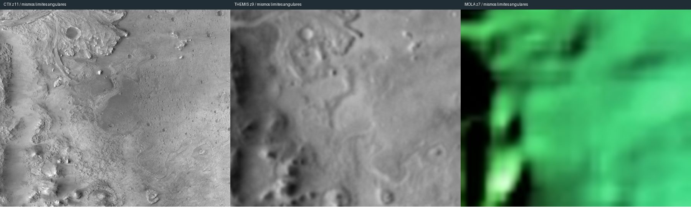

# Alineación de las capas de Jezero — 14/11/2026

## Método reproducible

`python3 scripts/check_wmts_alignment.py --image /tmp/jezero-comparison.jpg` consulta las tres URLs oficiales GetCapabilities, comprueba CRS, bbox y cuadrículas z0–z7, descarga teselas actuales y construye una comparación visual con **el mismo encuadre angular**. Requiere red; `--image` requiere Pillow solo para el pipeline offline. El script y la comparación no miden altura ni registran puntos de control.

Resultados observados al ejecutar el script equivalente sobre datos en vivo:

| Servicio | CRS | Niveles | Bbox GetCapabilities | z0–z7 respecto de CTX |
|---|---|---:|---|---|
| [CTX controlado Jezero](https://trek.nasa.gov/tiles/Mars/EQ/JEZ_ctx_B_soc_008_orthoMosaic_6m_Eqc_latTs0_lon0/1.0.0/WMTSCapabilities.xml) | `urn:ogc:def:crs:EPSG::104905` | 14 | 77.1604655–77.6991776°E; 18.2110274–18.7211945°N | referencia |
| [MOLA sombreado](https://trek.nasa.gov/tiles/Mars/EQ/Mars_MGS_MOLA_ClrShade_merge_global_463m/1.0.0/WMTSCapabilities.xml) | igual | 8 | casi global | idénticos |
| [THEMIS IR diurno](https://trek.nasa.gov/tiles/Mars/EQ/THEMIS_DayIR_ControlledMosaics_100m_v2_oct2018/1.0.0/WMTSCapabilities.xml) | igual | 10 | ~65°S–65°N | idénticos |

Las tres cuadrículas comparten origen `−180°, 90°`, z0 con escala `279227636.2980747`, ancho de matriz 2, tesela 256×256 y los niveles z0–z7 completos (origen, escala, tamaño, número de filas y columnas). El encuadre de comparación `[77.30,18.29,77.55,18.52]` cae dentro de los tres bbox. Esto **confirma la consistencia del posicionamiento declarado** entre capas en OpenLayers; no prueba que cada píxel corresponda a un mismo punto físico con precisión EVA.

## Evidencia visual y referencia externa

Imagen generada con el script a partir de teselas Mars Trek: CTX z11 (12 teselas), THEMIS z9 (2), MOLA z7 (2); recorte idéntico y remuestreo **solo para inspección visual**, sin procesar datos científicos. Se distingue el mismo cráter circular de la parte superior izquierda en CTX y THEMIS y rasgos de la escarpa occidental; MOLA conserva solo el relieve a gran escala. Las diferencias de textura/iluminación y resolución impiden medir un desplazamiento absoluto con esa comparación.

Referencias espaciales independientes: la [ficha USGS del ortomosaico CTX](https://www.usgs.gov/data/mars-2020-terrain-relative-navigation-context-camera-orthorectified-image-mosaic) identifica el mismo producto USGS de Jezero, y el [Gazetteer USGS/IAU de Jezero](https://planetarynames.wr.usgs.gov/Feature/14300) da centro ~77.69°E, 18.41°N en coordenadas **planetocéntricas +Este**, con extremo occidental ~77.27°E: el sector está en la región occidental, no en el centro del cráter. La observación [HiRISE ESP_045994_1985](https://www.uahirise.org/ESP_045994_1985) centra una imagen en 77.437°E, 18.427°N dentro del encuadre, pero el **centro de una observación no es un punto físico de control**; no se usa para reclamar exactitud métrica.

**Pendiente:** comparar al menos dos puntos de control **físicos** identificados con coordenadas y convención latitud/longitud compatibles en productos independientes; no se verificó el datum horizontal/convención de latitud específica de cada WMTS. MOLA ~463 m/píxel y THEMIS ~100 m/píxel no validan obstáculos pequeños ni coincidencia subpíxel con CTX ~6 m/píxel. Por tanto, alineación **de cuadrícula verificada**, exactitud **geodésica/píxel a píxel NO VERIFICADA**.
